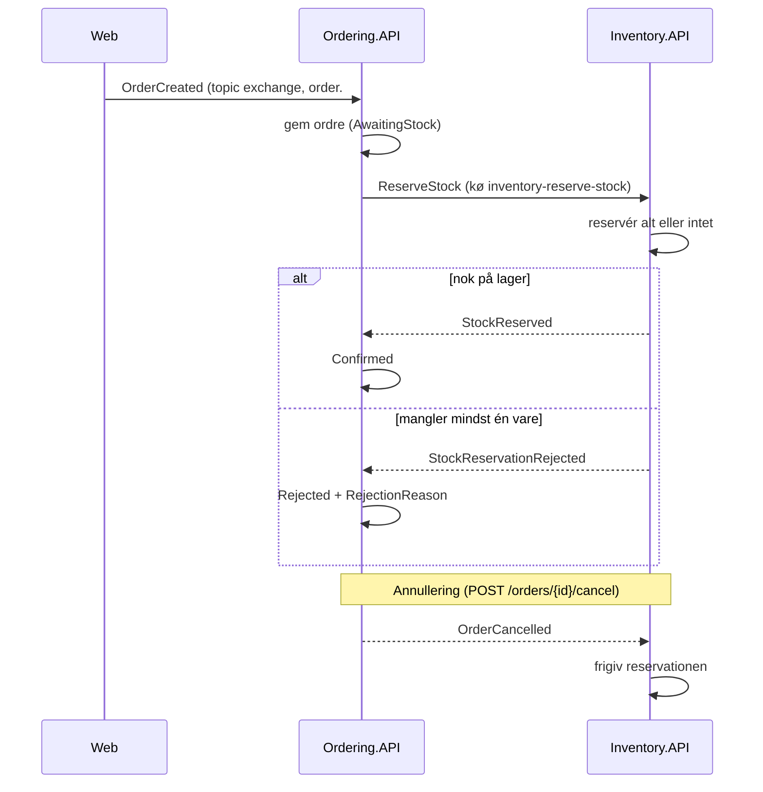

# Lagerservicen (Inventory.API)

Inventory.API holder styr på beholdningen, reserverer varer, når en ordre kommer ind, og frigiver dem igen,
hvis en bekræftet ordre annulleres. Servicen har sin egen SQLite-database og kender kun katalog-id og antal.

## Flow

## Køer, exchanges og mønstre

| Besked | Kanal | Mønster |
| --- | --- | --- |
| `OrderCreated` | Topic exchange `Contracts:OrderCreated` → kø `ordering-order-created` | Publish-Subscribe, Content-Based Router |
| `ReserveStock` | Kø `inventory-reserve-stock` | Command Message, Point-to-Point, Content Filter |
| `StockReserved`, `StockReservationRejected` | Exchanges `Contracts:StockReserved` og `Contracts:StockReservationRejected` → kø `ordering-stock-results` | Event Message, Publish-Subscribe |
| `OrderCancelled` | Exchange `Contracts:OrderCancelled` → kø `inventory-order-cancelled` | Event Message, kompenserende handling (saga) |
| Fejlede beskeder | `<kø>_error` | Invalid Message / Dead Letter Channel |

Reservationen gemmes pr. `OrderId`, så samme `ReserveStock` to gange kun reserverer én gang, men svaret sendes igen
(Idempotent Receiver; `OrderId` er correlation identifier).

## HTTP-endpoints (port 5500, Swagger på /swagger)

| Endpoint | Adgang |
| --- | --- |
| `GET /stock` | JWT fra PublicApi |
| `GET /stock/{catalogItemId}` | JWT |
| `POST /stock/{catalogItemId}/restock` med `{ "units": 10 }` | JWT med rollen Administrators |
| `GET /reservations/{orderId}` | JWT |
| `GET /health` | Alle |

## Beslutninger

- **Ordering.API starter reservationen**, ikke lageret selv. Ordering.API ejer ordrens status, og så kan svaret
  fra lageret ikke komme før ordren er gemt.
- **Alt eller intet** i én `SaveChanges` i stedet for Splitter/Aggregator pr. linje: en afvist ordre har intet reserveret,
  og der skal ikke rulles noget tilbage.
- **Asynkron reservation**: kunden venter ikke på lageret ved checkout. Ordren står kort som `AwaitingStock`.
- **Concurrency token** (`Version`) på `StockItem`: køber to kunder den sidste vare samtidig, fejler den ene
  `SaveChanges`, og MassTransit prøver igen med den nye beholdning.

## Kendte begrænsninger

- Ingen Transactional Outbox i Inventory.API og Ordering.API: de gemmer først og publicerer bagefter (at-least-once).
  Går et svar tabt, sendes det igen, når samme besked kommer igen.
- Startbeholdningen er fast (vare 1-12) og opdateres ikke, når kataloget får nye varer.
- Ordering.API bruger stadig `EnsureCreated()`; en ny kolonne kræver, at `ordering.db` slettes.
